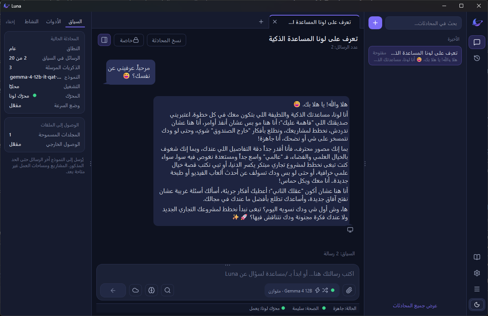
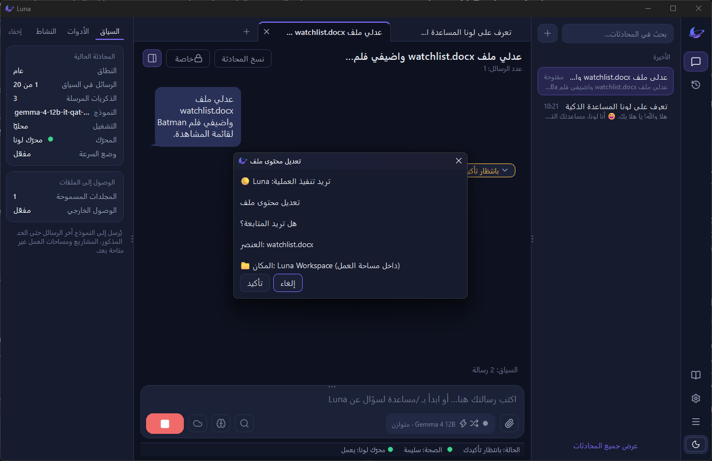
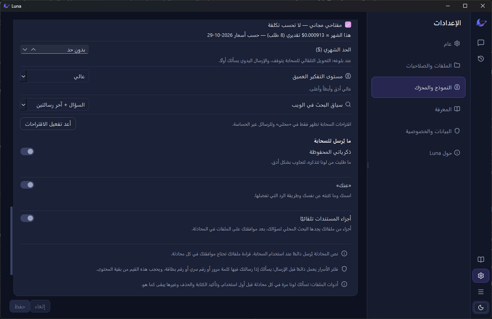

<div dir="rtl">

# Luna AI Desktop Assistant

### ذكاؤك. جهازك. قواعدك.

[English](README.md) · [العربية](README.ar.md)

لونا مساعد ذكي لسطح المكتب على Windows، يعمل مع ملفاتك على جهازك، ولا يغيّر أي ملف قبل أن يستأذنك. تحدّث معها بالعربية أو الإنجليزية، واختر بين ذكاء محلي يعمل على جهازك أو ذكاء سحابي من مزوّد تختاره أنت.

**[تنزيل Luna Beta 0.1](https://github.com/EinMM/lunaicore/releases/download/desktop-win-v0.1.0/LunaSetup-0.1.0.exe)** · [ملاحظات الإصدار](https://github.com/EinMM/lunaicore/releases/tag/desktop-win-v0.1.0) · [موقع المشروع](https://einmm.github.io/lunaicore/) · [دليل المجرّبين](TESTERS.ar.md)



## ماذا تستطيع لونا أن تفعل؟

- **تعمل مع ملفاتك بأمان:** اطلب منها قراءة الملفات أو إنشاءها أو تعديلها داخل مساحة عمل تحددها أنت. أي تغيير على ملف يحتاج تأكيدك.
- **اختر ذكاءك:** شغّل نموذجًا محليًا على جهازك، أو اربط مفتاح OpenAI أو Gemini الخاص بك للذكاء السحابي.
- **تتحدث العربية والإنجليزية** من خلال واجهة حديثة لسطح المكتب.
- **ذاكرة شخصية:** أنت تقرر ما تتذكره لونا، وتستطيع مراجعته أو حذفه من الإعدادات.
- **مساعدة داخل التطبيق:** اكتب `/help` لفتح الدليل المدمج.



## الخصوصية وأوضاع الذكاء

- **الوضع المحلي:** المحادثات والذكريات ومحتوى الملفات تبقى على جهازك.
- **الوضع السحابي:** تُرسل محادثتك إلى المزوّد السحابي الذي اخترته. وحسب إعدادات الخصوصية، قد تُرسل معها ذكريات أو معلومات ملف شخصي تختارها أنت.
- **التحكم بيدك:** لا تُرسل مقتطفات المستندات إلا إذا فعّلت هذا الخيار ووافقت على مشاركة الملفات. وأدوات الملفات السحابية لا تعمل إلا بعد سماحك لها في تلك المحادثة.
- **مفاتيح الـ API** تُحفظ في مدير بيانات الاعتماد في Windows (Credential Manager)، لا في ملفات نصية مكشوفة.
- **التحديثات:** تتحقق لونا من وجود إصدار جديد وتخبرك فقط، ولا تثبّت أي شيء بنفسها. ويمكنك إيقاف التحقق من التحديثات من الإعدادات.



## تثبيت Luna Beta 0.1

1. نزّل الملف [LunaSetup-0.1.0.exe](https://github.com/EinMM/lunaicore/releases/download/desktop-win-v0.1.0/LunaSetup-0.1.0.exe).
2. **يُنصح به:** تحقّق من سلامة الملف. افتح PowerShell في مجلد التنزيلات وشغّل:

</div>

```powershell
Get-FileHash .\LunaSetup-0.1.0.exe -Algorithm SHA256
```

<div dir="rtl">

يجب أن تطابق النتيجة:

</div>

```
2ED24C91382B8F8C5A6DED6797D0BFA05931C7FB508BB9096A386F6C7D30A1CC
```

<div dir="rtl">

3. شغّل ملف التثبيت. لا يحتاج صلاحيات المسؤول (Administrator).
4. قد يظهر لك تحذير «Windows protected your PC» لأن ملف التثبيت لا يحمل شهادة توقيع تجارية حتى الآن. إذا كانت البصمة مطابقة، اختر **More info ← Run anyway**.
5. اتبع خطوات الترحيب في لونا لإكمال الإعداد.

### المتطلبات

- يُنصح بـ Windows 11 بنظام 64-bit. لا يدعم هذا الإصدار التجريبي Windows 10 رسميًا؛ الذكاء السحابي عمل عليه في تجاربنا، لكن بعض الميزات قد لا تعمل كما هو متوقع.
- **للذكاء المحلي:** يُنصح بكرت شاشة بذاكرة 6 GB على الأقل، ومساحة فارغة بعدة جيجابايت للنموذج. تقترح لونا نموذجًا يناسب جهازك، ولا تنزّله إلا بعد موافقتك.
- **للذكاء السحابي:** اتصال بالإنترنت ومفتاح OpenAI أو Gemini خاص بك، ويعمل على الأجهزة الأخف.

## شاركنا رأيك

هذا إصدار تجريبي مبكر، وتجربتك تساعد في تشكيل ما سيأتي بعده. إذا كانت هذه أول مرة تجرّب فيها لونا، ابدأ بـ **[دليل المجرّبين](TESTERS.ar.md)**: يشرح ماذا تجرّب، وما يجب تجنبه، وكيف تكتب بلاغًا مفيدًا.

- من داخل لونا: **الإعدادات ← حول ← إرسال ملاحظات**
- [أبلغ عن مشكلة أو اطلب ميزة](https://github.com/EinMM/lunaicore/issues)
- البريد: [lunaicore@outlook.com](mailto:lunaicore@outlook.com)

## عن هذا المستودع

يحتوي هذا المستودع على موقع لونا العام وملفات الإصدارات، ولا يحتوي على الكود المصدري لتطبيق لونا.

- **التقنيات:** HTML وCSS وJavaScript وGitHub Pages. الموقع ثابت ولا يحتاج تطبيقًا على الخادم.
- **النشر:** يُنشر عبر GitHub Pages من الفرع `main`.

### حالة المشروع

Luna Beta 0.1 متاح لـ Windows 11. قد تتغير الميزات وطريقة التوفر مع استمرار التطوير.

</div>
