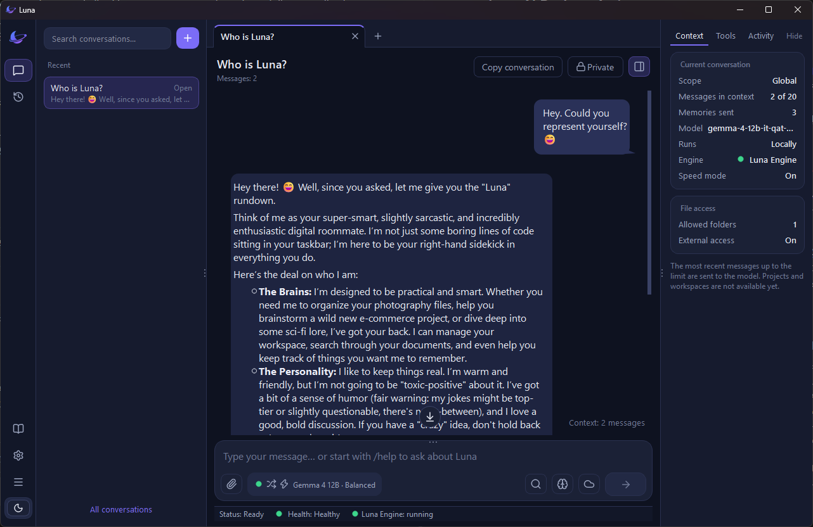
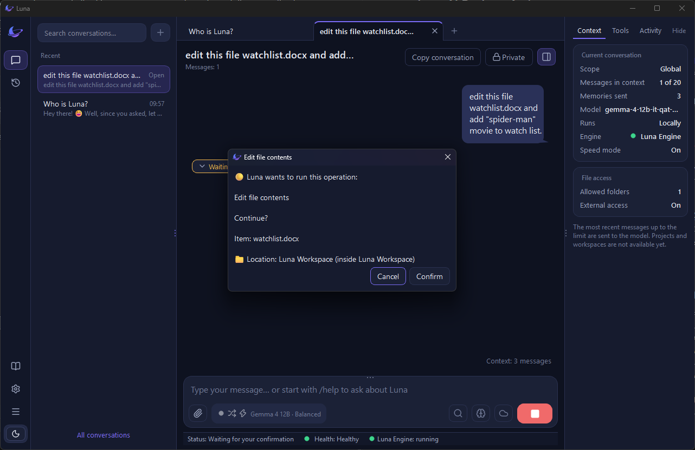
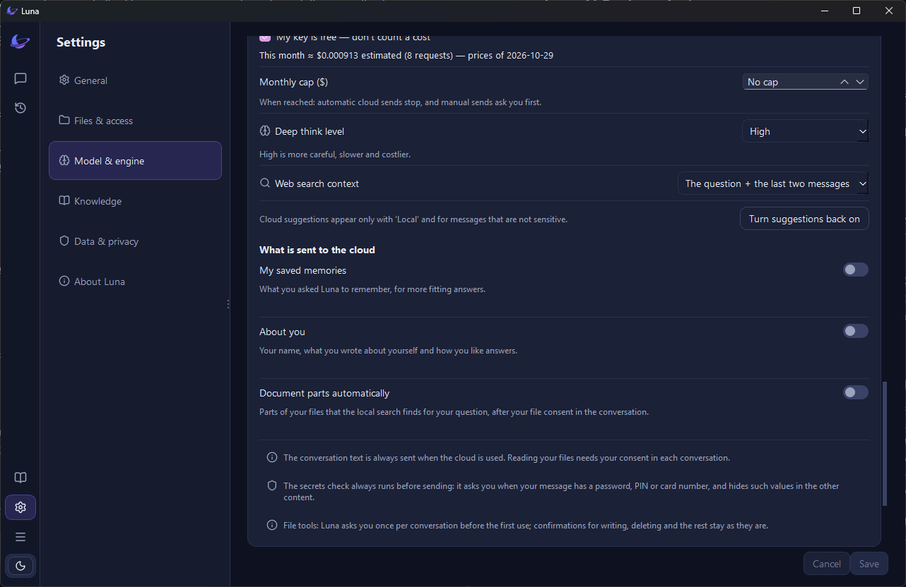

# Luna AI Desktop Assistant

### Your AI. Your PC. Your rules.

[English](README.md) · [العربية](README.ar.md)

Luna is a Windows desktop assistant that works with the files on your PC — and never changes them without asking you first. Chat in Arabic or English, and choose between local AI that runs on your own device and cloud AI from a provider you configure.

**[Download Luna Beta 0.1](https://github.com/EinMM/lunaicore/releases/download/desktop-win-v0.1.1/LunaSetup-0.1.1.exe)** · [Release notes](https://github.com/EinMM/lunaicore/releases/tag/desktop-win-v0.1.1) · [Project website](https://einmm.github.io/lunaicore/) · [Beta tester guide](TESTERS.md)



## What Luna can do

- **Work with your files, safely:** ask Luna to read, create, or edit files inside a workspace you choose. Every change to a file needs your confirmation.
- **Choose your AI:** run a local model on your PC, or connect your own OpenAI or Gemini API key for cloud AI.
- **Chat in Arabic or English** through a modern desktop interface.
- **Keep a personal memory:** you decide what Luna remembers, and you can review or delete it in Settings.
- **Get help in the app:** type `/help` for the built-in guide.



## Privacy and AI modes

- **Local mode:** conversations, memories, and file content stay on your device.
- **Cloud mode:** your conversation is sent to the cloud provider you selected. Depending on your privacy settings, selected memories or profile details may also be included.
- **You stay in control:** document excerpts are sent only when you enable that option and give file consent. Cloud file tools run only after you allow them for that conversation.
- **Your API keys** are stored in Windows Credential Manager, not in plain-text files.
- **Updates:** Luna checks for new versions and lets you know — it never installs anything by itself. You can turn off update checks in Settings.



## Install Luna Beta 0.1

1. Download [LunaSetup-0.1.1.exe](https://github.com/EinMM/lunaicore/releases/download/desktop-win-v0.1.1/LunaSetup-0.1.1.exe).
2. **Recommended:** verify the download. Open PowerShell in your Downloads folder and run:

   ```powershell
   Get-FileHash .\LunaSetup-0.1.1.exe -Algorithm SHA256
   ```

   The result should match:

   ```
   6DC247705961FC37EDA70AA36D2582E7E8D7CAD245D6C8102957072EA09C2028
   ```

3. Run the installer and accept the Terms of Use and Privacy Policy pages. Administrator rights are not required.
4. Windows may show “Windows protected your PC” because the installer does not have a commercial code-signing certificate yet. If the file hash matches, select **More info → Run anyway**.
5. Follow Luna’s welcome steps to finish setup.

### Requirements

- Windows 11 (64-bit) is recommended. Windows 10 is not officially supported in this beta — cloud AI works on it in our testing, but some features may not work as expected.
- **For local AI:** a GPU with at least 6 GB of VRAM is recommended, plus several GB of free disk space for the model. Luna suggests a model that fits your hardware and downloads it only after you confirm.
- **For cloud AI:** an internet connection and your own OpenAI or Gemini API key. This works on lighter hardware.

## Share feedback

This is an early beta, and your experience can help shape what comes next. New to testing Luna? Start with the **[Beta tester guide](TESTERS.md)** — it covers what to test, what to avoid, and how to write a useful report.

- In Luna: the **Send feedback** button in the side bar (also in **Settings → About**)
- [Report an issue or request a feature](https://github.com/EinMM/lunaicore/issues)
- Email: [lunaicore@outlook.com](mailto:lunaicore@outlook.com)

## About this repository

This repository contains Luna’s public website and release files. It does not contain the source code for the Luna desktop application.

- **Built with:** HTML, CSS, JavaScript, and GitHub Pages. The website is static and has no server-side application.
- **Deployment:** published through GitHub Pages from the `main` branch.

### Project status

Luna Beta 0.1 is available for Windows 11. Features and availability may change as development continues.
